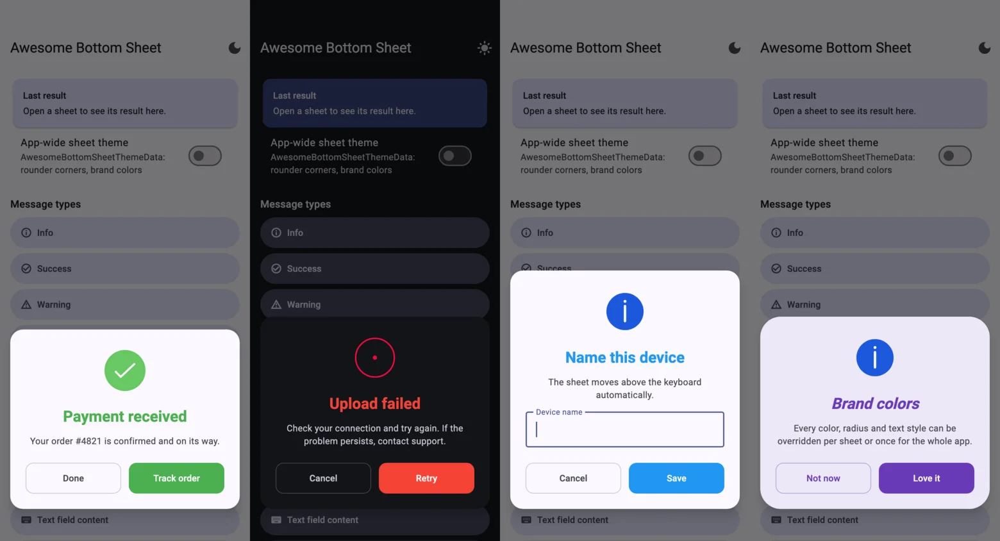

# Awesome Bottom Sheet

[](https://pub.dev/packages/awesome_bottom_sheet)
[](https://pub.dev/packages/awesome_bottom_sheet/score)
[](https://pub.dev/packages/awesome_bottom_sheet)
[](https://github.com/AHMED-HOMISHAN/awesome_bottom_sheet/actions/workflows/ci.yml)
[](LICENSE)

Animated **feedback bottom sheets** for Flutter. Show a success, error,
warning or info message as a modal bottom sheet with an animated Lottie icon,
two buttons and a typed result you can `await`. Looks right in light and dark
mode, on phones, tablets and the web, with no setup.

<p align="center">
  
</p>

```dart
final result = await AwesomeBottomSheet.showSuccess(
  context: context,
  title: 'Payment received',
  description: 'Your order is confirmed and on its way.',
  primaryButtonText: 'Track order',
  secondaryButtonText: 'Done',
);
if (result.isPrimary) openTracking();
```

## Why this package

| | `awesome_bottom_sheet` | `showModalBottomSheet` | Alert-dialog packages |
|---|---|---|---|
| Ready-made success / error / warning / info sheets | ✅ | ❌ build it yourself | ✅ as dialogs |
| Bottom-sheet presentation (thumb-reachable, Material 3) | ✅ | ✅ | ❌ |
| Animated Lottie icons, bundled, no assets to register | ✅ | ❌ | partly (Rive / images) |
| Typed result (`primary`, `secondary`, `dismissed`, `autoDismissed`) | ✅ | `T?` you define | callbacks |
| Dark mode from your `ColorScheme`, app-wide `ThemeExtension` | ✅ | manual | partly |
| Keyboard, safe area, long content and tablet width handled | ✅ | manual | varies |
| Reduced-motion and screen-reader support | ✅ | manual | varies |

If you need general sheet mechanics such as snapping, nested navigation or
multi-page flows, pair this package with `smooth_sheets` or
`wolt_modal_sheet`. This package stays focused on one thing: telling the
user what just happened.

## Installation

```yaml
dependencies:
  awesome_bottom_sheet: ^1.0.0
```

```sh
flutter pub get
```

Requires Flutter 3.47 or newer. The package builds on the standalone
[`material_ui`](https://pub.dev/packages/material_ui) library that Flutter
moved Material widgets into; see [Compatibility](#compatibility).

## Quick start

```dart
import 'package:awesome_bottom_sheet/awesome_bottom_sheet.dart';

await AwesomeBottomSheet.showInfo(
  context: context,
  title: 'Did you know?',
  description: 'Every sheet can be awaited.',
);
```

Four shortcuts cover the common cases, and `show` takes the type as a value:

```dart
AwesomeBottomSheet.showSuccess(context: context, title: 'Saved');
AwesomeBottomSheet.showError(context: context, title: 'Upload failed');
AwesomeBottomSheet.showWarning(context: context, title: 'Unsaved changes');
AwesomeBottomSheet.showInfo(context: context, title: 'Heads up');

AwesomeBottomSheet.show(
  context: context,
  type: ok ? AwesomeMessageType.success : AwesomeMessageType.error,
  title: ok ? 'Done' : 'Something went wrong',
);
```

## Usage

### React to the result

Every method resolves with an `AwesomeMessageResult`, so you rarely need
callbacks:

```dart
final result = await AwesomeBottomSheet.showWarning(
  context: context,
  title: 'Delete account?',
  description: 'This cannot be undone.',
  primaryButtonText: 'Delete',
  secondaryButtonText: 'Keep',
);

switch (result) {
  case AwesomeMessageResult.primary:
    await deleteAccount();
  case AwesomeMessageResult.secondary:
  case AwesomeMessageResult.dismissed:
  case AwesomeMessageResult.autoDismissed:
    break;
}
```

`onPrimaryPressed` and `onSecondaryPressed` are still available. They run
after the sheet has closed, so it is safe to navigate from them.

### Buttons

```dart
AwesomeBottomSheet.showError(
  context: context,
  title: 'Upload failed',
  primaryButtonText: 'Retry',
  secondaryButtonText: 'Cancel',
  primaryButtonColor: Colors.red.shade700,     // defaults to the accent color
  primaryButtonTextColor: Colors.white,        // defaults to a readable color
  secondaryButtonColor: Colors.red.shade200,   // outline color
  secondaryButtonTextColor: Colors.red.shade700,
);

// One full-width button
AwesomeBottomSheet.showSuccess(
  context: context,
  title: 'All caught up',
  showSecondaryButton: false,
  primaryButtonText: 'Great',
);
```

### Colors, radius and text styles

```dart
AwesomeBottomSheet.showInfo(
  context: context,
  title: 'Brand colors',
  accentColor: Colors.deepPurple,            // title + primary button
  backgroundColor: Colors.deepPurple.shade50,
  borderRadius: const BorderRadius.all(Radius.circular(32)),
  titleStyle: const TextStyle(letterSpacing: 0.5),
  descriptionStyle: const TextStyle(height: 1.5),
);
```

### Icons

```dart
// Any widget
AwesomeBottomSheet.showInfo(
  context: context,
  title: 'Launching',
  icon: const Icon(Icons.rocket_launch, size: 72, color: Colors.orange),
);

// Your own Lottie file
AwesomeBottomSheet.showSuccess(
  context: context,
  title: 'Order placed',
  customLottieAsset: 'assets/animations/confetti.json',
);
```

### Extra content and the keyboard

`content` accepts any widget. The sheet moves above the keyboard and scrolls
long content while the buttons stay reachable.

```dart
final controller = TextEditingController();

final result = await AwesomeBottomSheet.showInfo(
  context: context,
  title: 'Name this device',
  content: TextField(
    controller: controller,
    autofocus: true,
    decoration: const InputDecoration(labelText: 'Device name'),
  ),
  primaryButtonText: 'Save',
);
if (result.isPrimary) save(controller.text);
```

### Auto dismiss

```dart
AwesomeBottomSheet.showSuccess(
  context: context,
  title: 'Copied',
  showSecondaryButton: false,
  autoDismissAfter: const Duration(seconds: 2), // resolves with autoDismissed
);
```

### Non-dismissible sheets

With `barrierDismissible: false` the barrier tap, the drag-down gesture and
the system back gesture are all disabled. Only the buttons close the sheet.

```dart
await AwesomeBottomSheet.showWarning(
  context: context,
  title: 'Accept the new terms',
  barrierDismissible: false,
  primaryButtonText: 'Accept',
  secondaryButtonText: 'Read terms',
);
```

### Reuse a configuration

```dart
const networkError = AwesomeMessageConfig(
  type: AwesomeMessageType.error,
  title: 'No connection',
  description: 'Check your network and try again.',
  primaryButtonText: 'Retry',
);

final result = await AwesomeBottomSheet.showConfig(
  context: context,
  config: networkError.copyWith(description: 'Still offline.'),
);
```

### Style every sheet at once

Install `AwesomeBottomSheetThemeData` in your `ThemeData`. Values set on a
single sheet override it; anything left unset falls back to your
`ColorScheme`.

```dart
MaterialApp(
  theme: ThemeData(
    colorScheme: ColorScheme.fromSeed(seedColor: Colors.indigo),
    extensions: const [
      AwesomeBottomSheetThemeData(
        borderRadius: BorderRadius.all(Radius.circular(28)),
        maxWidth: 480,
        iconSize: 96,
        successColor: Color(0xFF2E7D32),
        errorColor: Color(0xFFC62828),
        titleStyle: TextStyle(letterSpacing: 0.5),
      ),
    ],
  ),
);
```

### Use the widget directly

`AwesomeMessageBottomSheet` is the card inside the route. Use it with your
own `showModalBottomSheet` call or a declarative router when you need control
over the route itself.

```dart
final result = await showModalBottomSheet<AwesomeMessageResult>(
  context: context,
  isScrollControlled: true,
  backgroundColor: Colors.transparent,
  builder: (_) => const AwesomeMessageBottomSheet(
    config: AwesomeMessageConfig(type: AwesomeMessageType.info, title: 'Hi'),
  ),
);
```

## API overview

| Symbol | Purpose |
|---|---|
| `AwesomeBottomSheet.show` / `showInfo` / `showSuccess` / `showWarning` / `showError` | Open a sheet from named parameters. Returns `Future<AwesomeMessageResult>`. |
| `AwesomeBottomSheet.showConfig` | Open a sheet from an `AwesomeMessageConfig`. |
| `AwesomeMessageConfig` | Immutable description of one sheet, with `copyWith`. |
| `AwesomeMessageResult` | `primary`, `secondary`, `dismissed`, `autoDismissed` plus `isPrimary` / `isSecondary` / `isDismissed`. |
| `AwesomeMessageType` | `info`, `success`, `warning`, `error` with `defaultColor` and `label`. |
| `AwesomeBottomSheetThemeData` | `ThemeExtension` with app-wide defaults. |
| `AwesomeMessageBottomSheet` | The sheet widget, for custom routes. |
| `LottieAnimations`, `LottieData` | The bundled animations and the in-memory animation model. |

Route options forwarded to `showModalBottomSheet`: `useRootNavigator`,
`routeSettings`, `barrierColor`.

Full reference: [pub.dev API docs](https://pub.dev/documentation/awesome_bottom_sheet/latest/).

## Behavior and accessibility

- **Dark mode**: background, description and secondary button colors come
  from `Theme.of(context).colorScheme`.
- **Layout**: respects the bottom safe area, moves above the keyboard, scrolls
  long descriptions and caps the card at 560 px on wide screens.
- **Motion**: content fades and the icon scales in over 350 ms. When the
  platform requests reduced motion the entrance animation is skipped and the
  icon plays once.
- **Semantics**: the title is announced as a header and the decorative icon is
  hidden from assistive technology. Buttons are at least 48 px tall.
- **RTL**: the button row mirrors automatically.

## Compatibility

| awesome_bottom_sheet | Flutter | Dart | Material import |
|---|---|---|---|
| 1.x | ≥ 3.47 | ≥ 3.13 | `package:material_ui` |
| 0.0.x | ≥ 3.27 | ≥ 3.6 | `package:flutter/material.dart` (deprecated in Flutter 3.50) |

Flutter moved its Material and Cupertino widgets into the standalone
`material_ui` and `cupertino_ui` packages and deprecated the in-framework
imports in Flutter 3.50. A package that still imports
`package:flutter/material.dart` crashes with `No MaterialLocalizations found`
inside apps that already migrated, so 1.0.0 follows the
[official migration guide](https://docs.flutter.dev/release/breaking-changes/material-ui-and-cupertino-ui).
Your app does not have to migrate first: `material_ui` works alongside the
old imports.

Platforms: Android, iOS, web, macOS, Windows, Linux.

## Migrating from 0.x

1. Upgrade Flutter to 3.47 or newer and bump the dependency to `^1.0.0`.
2. Replace `AwesomeMessageService` with `AwesomeBottomSheet`. The old name
   still works but is deprecated.
3. Sheets are now dismissible by default. Add `barrierDismissible: false`
   where you relied on the old default.
4. If you passed a type argument such as `showInfo<void>(...)`, remove it. The
   methods return `Future<AwesomeMessageResult>`.
5. Do not call `Navigator.pop` inside `onPrimaryPressed` to close the sheet.
   It has already closed; that call would pop the page underneath.
6. If you used `LottieData.toJsonString()` or `formattedJson`, switch to
   `LottieData.bytes`.

## Example app

The [example](example/lib/main.dart) exercises every feature, including dark
mode and the theme extension:

```sh
cd example && flutter run
```

## Credits

The bundled animations were published on
[LottieFiles](https://lottiefiles.com) under the Lottie Simple License. The
info and warning icons are by Bilal Arief.

## Contributing

Bug reports and pull requests are welcome. See
[CONTRIBUTING.md](CONTRIBUTING.md) for the workflow and release process.

## License

MIT. See [LICENSE](LICENSE).
